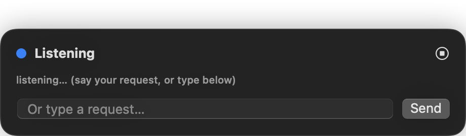
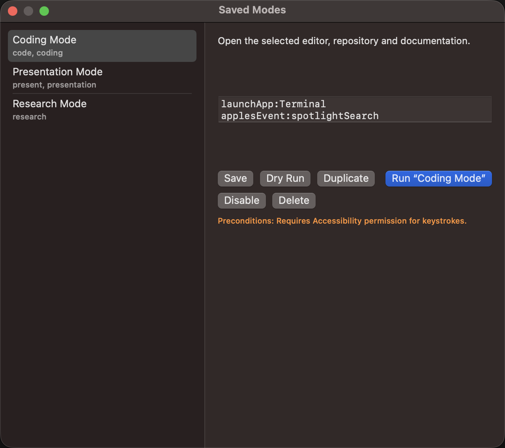
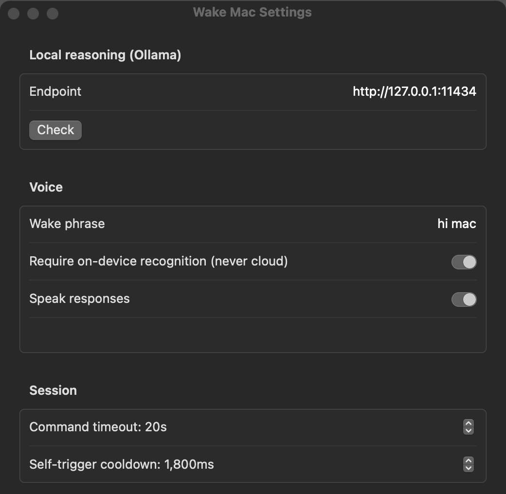
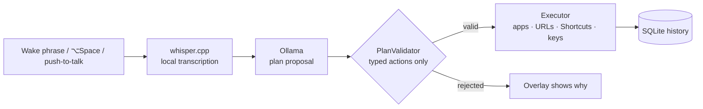

<div align="center">

# Wake Mac

**A menu-bar voice assistant for macOS that runs entirely on your machine.**

Say *"hi mac"*, speak a request, and Wake Mac turns it into a short, validated plan of Mac
actions (open an app, a URL or a folder, run a Shortcut, type text, press a key) and carries it out.


-4B32C3)
-111111)




</div>

**Nothing leaves the Mac.** Speech is transcribed by a local
[whisper.cpp](https://github.com/ggerganov/whisper.cpp) model, and planning runs on a local
[Ollama](https://ollama.com) model.

## Screenshots

All screenshots are from the app running on macOS.

| Saved modes | Settings |
|---|---|
|  |  |

## Features

- **Wake phrase, hotkey and push-to-talk.** Say the wake phrase, press <kbd>⌥ Space</kbd>, or hold
  the push-to-talk key. The overlay shows what it heard and what will run, and you can type a request instead.
- **Typed action plans.** The model only *proposes* steps. `PlanValidator` checks every step against a
  fixed set of action kinds before anything runs, so the model never executes anything directly.
- **Saved modes**: named routines such as *Coding Mode*, *Presentation Mode* or *Research Mode*,
  triggered by voice aliases. They support dry run, enable/disable, duplicate, and preconditions
  (for example, "requires Accessibility permission").
- **History** of requests and results in a local SQLite store.
- **Optional spoken responses** and on-device-only recognition (never falls back to the cloud).

Supported action kinds: `launchApp`, `openURL`, `openPath`, `runShortcut`, `applesEvent` (fixed
templates only), `typeText`, `keystroke`, `waitSeconds`, `setVolume`.

## How it works



## Requirements

- macOS 15+ on Apple Silicon
- `whisper-cli` from whisper.cpp (`brew install whisper-cpp`) with the `ggml-base.en.bin` (wake) and
  `ggml-small.en.bin` (request) models
- [Ollama](https://ollama.com) running at `http://127.0.0.1:11434`
- Full Xcode only for running the tests (Swift Testing)

## Build and run

```bash
git clone https://github.com/MohamedHamed163/WakeMac.git
cd WakeMac
swift build
./scripts/make_app.sh          # assembles build/WakeMac.app
open build/WakeMac.app
```

The app lives in the menu bar (waveform icon): **Wake Mac**, **Show Overlay**, **Settings…**, **Modes…**.
On first use macOS asks for Microphone and Speech Recognition permission. Keystroke actions also need Accessibility permission.

Tests:

```bash
DEVELOPER_DIR=/Applications/Xcode.app/Contents/Developer swift test
```

## Project layout

| Path | Contents |
|---|---|
| `Sources/WakeKit` | Core library: actions, planner and modes, speech pipeline, Whisper engine, Ollama client, SQLite history |
| `Sources/WakeMacApp` | Menu-bar app: status item, overlays, settings and modes windows |
| `Tests/WakeKitTests` | Unit tests (21 tests) |

## Related

- [NotchWiki](https://github.com/MohamedHamed163/NotchWiki): local-first knowledge workspace for macOS
